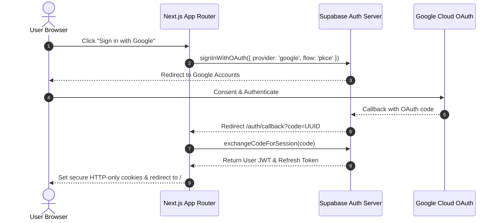

# SAHAYAK AI (सहायक) &bull; Complete End-to-End Technical Specification

> **Version**: 1.0.0  
> **Target Platform**: Next.js 16 (App Router), Node.js LTS 24, Vercel Serverless  
> **Database & Auth**: Supabase (PostgreSQL with RLS, Google OAuth via SSR PKCE)  
> **Real-Time Speech Engine**: Google Gemini Multimodal Live API (`@google/genai` v3.6.1, Model: `gemini-3.8-live`)  
> **Deployment Origin**: Vercel HTTPS Edge + Supabase Cloud  

---

## 1. Executive Summary & Vision

**SAHAYAK AI (सहायक)** is a production-grade, accessible, bidirectional voice assistant engineered specifically for fluent, low-latency conversational speech in both **Hindi (हिन्दी)** and **English**. It enables users to have hands-free, one-on-one voice calls through their web browser without requiring physical keyboards or static text chats.

### Core Experience Pillars
1. **Speech-to-Speech Real-Time Call**: Continuous full-duplex conversational audio stream over WebSockets. Users speak naturally and immediately hear spoken responses from Google Gemini Live.
2. **True Multilingualism & Code-Switching**: Native support for Devanagari Hindi, Indian English, and everyday colloquial **Hinglish** code-switching. Proper nouns and technical vocabulary (e.g., "doctor", "internet", "station") remain natural without forced translation.
3. **Edge-Direct Audio Architecture**: Continuous high-bandwidth audio flows directly between the user's browser and Google's Gemini Live servers using single-use ephemeral session tokens. Heavy audio streams **never** proxy through Vercel serverless functions, guaranteeing low latency and zero server-side egress bottlenecks.
4. **Instant Interruption**: When a user begins speaking while the assistant is talking, the assistant stops instantly, discards queued audio buffers, and processes the new turn.
5. **Zero Audio Retention Privacy**: Raw microphone audio is processed in real time and never stored on any server. Users maintain full control over whether text transcripts are saved or purged.

---

## 2. High-Level System Architecture

```mermaid
flowchart TD
    subgraph Client["Client Browser (Chrome / Edge / Safari / Mobile)"]
        UI["Voice Call Interface\n(Pulsating Voice Orb + Subtitles)"]
        AudioEngine["Web Audio Pipeline\n(AudioContext @ 24kHz/48kHz)"]
        Recorder["AudioRecorder + Adaptive VAD\n(Resample 48k/44.1k -> 16k PCM)"]
        Player["AudioPlayer Buffer Queue\n(24k PCM Playback)"]
        LiveWS["GeminiLiveClient\n(WebSocket BidiGenerateContent)"]
    end

    subgraph Vercel["Vercel Serverless Hosting"]
        SSR["Next.js 16 App Router\n(SSR + Static HTML)"]
        TokenRoute["POST /api/live/token\n(Server-Side Auth & Rate Limiter)"]
        AuthCallback["GET /auth/callback\n(PKCE Code Exchange)"]
    end

    subgraph Supabase["Supabase Cloud Infrastructure"]
        SupaAuth["Supabase Auth\n(Google OAuth PKCE)"]
        Postgres["PostgreSQL Database\n(Row Level Security Enabled)"]
        RateLimitFn["check_and_increment_token_limit()\n(Atomic PL/pgSQL Function)"]
    end

    subgraph Google["Google Cloud & Gemini"]
        GoogleAuth["Google Cloud Console\n(OAuth 2.0 Credentials)"]
        GeminiLive["Gemini Live WebSocket Server\n(gemini-3.8-live @ v1alpha)"]
    end

    %% Auth Flow
    UI -->|"1. Sign In (Google OAuth)"| SupaAuth
    SupaAuth -->|"2. Redirect to Google Consent"| GoogleAuth
    GoogleAuth -->|"3. Authorized Redirect"| SupaAuth
    SupaAuth -->|"4. App Redirect"| AuthCallback
    AuthCallback -->|"5. Set Session Cookies"| SSR

    %% Ephemeral Token Flow
    UI -->|"6. POST /api/live/token (Bearer Session)"| TokenRoute
    TokenRoute -->|"7. Verify User & Check RLS"| Postgres
    TokenRoute -->|"8. Execute Rate Limit Check"| RateLimitFn
    TokenRoute -->|"9. ai.authTokens.create()"| Google
    TokenRoute -->>|"10. Return Ephemeral Token (60s window)"| UI

    %% Live Voice Call Flow
    LiveWS <===>|"11. Direct WebSocket Stream (PCM16 Audio)"| GeminiLive
    Recorder -->|"16kHz Linear PCM Chunks"| LiveWS
    LiveWS -->|"24kHz Linear PCM Audio + Transcription"| Player
    Player --> UI
```

---

## 3. Audio Pipeline & Digital Signal Processing (DSP)

The client audio engine is isolated strictly from server-only code and operates across two dedicated modules: `AudioRecorder` and `AudioPlayer`.

### 3.1 Audio Capture & Resampling (`AudioRecorder`)
- **Hardware Capture**: Invoked via `navigator.mediaDevices.getUserMedia` with hardware echo cancellation (`echoCancellation: true`), noise suppression (`noiseSuppression: true`), and auto gain control (`autoGainControl: true`).
- **Sample Rate Conversion**: Client audio interfaces typically run at $44,100\text{ Hz}$ or $48,000\text{ Hz}$. Gemini Live strictly expects single-channel, 16-bit linear PCM at $16,000\text{ Hz}$.
- **Linear Resampling Algorithm**:
  $$\text{ratio} = \frac{\text{fromRate}}{\text{toRate}}$$
  For each output sample $i$:
  $$\text{index} = i \times \text{ratio}, \quad \text{i1} = \lfloor \text{index} \rfloor, \quad \text{i2} = \min(\text{i1} + 1, N-1)$$
  $$\text{weight} = \text{index} - \text{i1}$$
  $$\text{sample} = (1 - \text{weight}) \times \text{input}[\text{i1}] + \text{weight} \times \text{input}[\text{i2}]$$
- **16-bit PCM Quantization & Little-Endian Packing**:
  Each 32-bit floating-point sample $s \in [-1.0, 1.0]$ is clamped and mapped to a signed 16-bit integer:
  $$s_{\text{clamped}} = \max(-1.0, \min(1.0, s))$$
  $$\text{val} = \operatorname{round}\left( s_{\text{clamped}} < 0 \;?\; s_{\text{clamped}} \times 32768 \;:\; s_{\text{clamped}} \times 32767 \right)$$
  Stored as 2 bytes in Little-Endian byte order.

### 3.2 Voice Activity Detection (VAD) & Anti-Noise Filtering
To eliminate false triggers caused by microphone turn-on spikes and room noise, `AudioRecorder` features an adaptive multi-stage VAD:

| Stage | Mechanism | Purpose |
| :--- | :--- | :--- |
| **Warmup Discard** | Discards all samples for the first $750\text{ ms}$ after mic activation | Prevents OS microphone initialization clicks from being registered as speech. |
| **Noise Floor Tracking** | Moving average: $\text{noiseFloor} = 0.98 \times \text{noiseFloor} + 0.02 \times \text{rms}$ | Dynamically measures the ambient background noise of the room. |
| **Adaptive Speech Threshold** | $\text{threshold} = \max(0.038, \; \text{noiseFloor} \times 2.8)$ | Ensures sensitivity remains above room hum and laptop fan noise. |
| **Voiced Frame Qualification** | Requires $\ge 4$ consecutive voiced frames ($\sim 170\text{ ms}$) | Filters out isolated non-speech transients (coughs, key clicks). |
| **Minimum Voiced Energy Check** | Requires $\ge 8$ total voiced frames ($\sim 350\text{ ms}$) during turn | Rejects brief noises before sending turn signals. |
| **Turn Completion Signal** | $1100\text{ ms}$ silence window after confirmed speech | Dispatches `{ clientContent: { turnComplete: true } }` to prompt Gemini Live. |

### 3.3 Audio Playback Engine (`AudioPlayer`)
- **Web Audio Context Unlocking**: In modern browsers (especially Google Chrome on Windows/macOS), calling `new AudioContext({ sampleRate: 24000 })` throws `NotSupportedError` when hardware only supports $48\text{ kHz}$. `AudioPlayer` initializes at native hardware rate and uses `ctx.createBuffer(1, length, 24000)` where the browser natively resamples playback.
- **Autoplay Permission Handshake**: A silent 1-sample buffer is played synchronously within the user gesture handler to permanently unlock Web Audio playback.
- **Timestamp Scheduling**: To eliminate gaps and audio clicking, chunks are queued using precise timeline calculation:
  $$\text{startTime} = \max(\text{currentTime}, \text{nextPlayTime})$$
  $$\text{nextPlayTime} = \text{startTime} + \text{buffer.duration}$$
- **Bounded Buffer Capacity**: Buffer queue capacity is bounded to 2,000 chunks ($\sim 40\text{ seconds}$) preventing memory leaks.
- **Instant Interruption**: When an interruption occurs (user speaks or taps *Interrupt*), all active `AudioBufferSourceNode` instances are immediately stopped and disconnected, and the queue is cleared.

---

## 4. Google Gemini Live Protocol Integration

### 4.1 Ephemeral Token Minting
To keep the master `GEMINI_API_KEY` private and out of client code, the browser calls `POST /api/live/token`. The server exchanges credentials via `@google/genai`:

```typescript
const ai = new GoogleGenAI({
  apiKey: config.geminiApiKey,
  httpOptions: { apiVersion: 'v1alpha' },
});

const tokenResponse = await ai.authTokens.create({
  config: {
    uses: 1, // Single-use session credential
    expireTime: new Date(Date.now() + 30 * 60 * 1000).toISOString(), // 30 min session
    newSessionExpireTime: new Date(Date.now() + 60 * 1000).toISOString(), // 60s handshake window
    liveConnectConstraints: {
      model: 'gemini-3.8-live',
      config: {
        responseModalities: [Modality.AUDIO],
        systemInstruction: { parts: [{ text: systemInstruction }] },
      },
    },
  },
});
```

### 4.2 WebSocket Connection & Wire Protocol
The client establishes a direct WebSocket connection:
```
wss://generativelanguage.googleapis.com/ws/google.ai.generativelanguage.v1alpha.GenerativeService.BidiGenerateContentConstrained?access_token=<EPHEMERAL_TOKEN>
```

#### Handshake Sequence
1. **Client Setup Frame**:
   ```json
   {
     "setup": {
       "model": "models/gemini-3.8-live",
       "generationConfig": {
         "responseModalities": ["AUDIO"],
         "speechConfig": {
           "voiceConfig": {
             "prebuiltVoiceConfig": { "voiceName": "Aoede" }
           }
         }
       }
     }
   }
   ```
2. **Server Confirmation**:
   ```json
   { "setupComplete": {} }
   ```
3. **Continuous Audio Ingestion**:
   ```json
   {
     "realtimeInput": {
       "mediaChunks": [
         {
           "mimeType": "audio/pcm;rate=16000",
           "data": "<BASE64_PCM16_BYTES>"
         }
       ]
     }
   }
   ```
4. **Turn Completion Signal**:
   ```json
   {
     "clientContent": {
       "turnComplete": true
     }
   }
   ```
5. **Server Streaming Response**:
   - `serverContent.outputTranscription.text`: Real-time spoken subtitles.
   - `serverContent.modelTurn.parts[].inlineData.data`: 24 kHz linear PCM audio chunks.
   - `serverContent.interrupted`: Boolean flag indicating user interrupted model.
   - `serverContent.turnComplete`: Signals model finished speaking.

---

## 5. Security & Authentication Architecture

### 5.1 Google OAuth with Supabase SSR (PKCE Flow)
Authentication is built with `@supabase/ssr` leveraging Proof Key for Code Exchange (PKCE) with HTTP-only secure cookies:



### 5.2 Redirect URL Topology
To prevent open-redirect vulnerabilities and domain mismatches:
1. **Google Cloud Console** &rarr; *APIs & Services* &rarr; *Credentials* &rarr; *Authorized redirect URIs*:
   ```
   https://<SUPABASE_PROJECT_ID>.supabase.co/auth/v1/callback
   ```
2. **Supabase Dashboard** &rarr; *Authentication* &rarr; *URL Configuration* &rarr; *Redirect URLs*:
   ```
   http://localhost:3000/auth/callback
   https://<PRODUCTION_DOMAIN>.vercel.app/auth/callback
   ```

---

## 6. Database Schema & SQL Migrations

All migrations reside under `supabase/migrations/` and enforce strict Row Level Security (RLS) ensuring absolute multi-tenant tenant isolation.

### Migration 001: User Profiles & Language Preferences
```sql
CREATE TABLE IF NOT EXISTS public.user_preferences (
  user_id UUID PRIMARY KEY REFERENCES auth.users(id) ON DELETE CASCADE,
  language VARCHAR(5) NOT NULL DEFAULT 'en' CHECK (language IN ('en', 'hi')),
  save_transcripts BOOLEAN NOT NULL DEFAULT false,
  created_at TIMESTAMPTZ NOT NULL DEFAULT timezone('utc'::text, now()),
  updated_at TIMESTAMPTZ NOT NULL DEFAULT timezone('utc'::text, now())
);

ALTER TABLE public.user_preferences ENABLE ROW LEVEL SECURITY;

CREATE POLICY "Users can view own preferences"
  ON public.user_preferences FOR SELECT
  USING (auth.uid() = user_id);

CREATE POLICY "Users can insert own preferences"
  ON public.user_preferences FOR INSERT
  WITH CHECK (auth.uid() = user_id);

CREATE POLICY "Users can update own preferences"
  ON public.user_preferences FOR UPDATE
  USING (auth.uid() = user_id);
```

### Migration 002: Conversation Metadata
```sql
CREATE TABLE IF NOT EXISTS public.conversations (
  id UUID PRIMARY KEY DEFAULT gen_random_uuid(),
  user_id UUID NOT NULL REFERENCES auth.users(id) ON DELETE CASCADE,
  title TEXT NOT NULL DEFAULT 'New Conversation',
  language VARCHAR(5) NOT NULL DEFAULT 'en' CHECK (language IN ('en', 'hi')),
  created_at TIMESTAMPTZ NOT NULL DEFAULT timezone('utc'::text, now()),
  updated_at TIMESTAMPTZ NOT NULL DEFAULT timezone('utc'::text, now()),
  CONSTRAINT unique_conversation_user UNIQUE (id, user_id)
);

ALTER TABLE public.conversations ENABLE ROW LEVEL SECURITY;

CREATE POLICY "Users can view own conversations"
  ON public.conversations FOR SELECT
  USING (auth.uid() = user_id);

CREATE POLICY "Users can insert own conversations"
  ON public.conversations FOR INSERT
  WITH CHECK (auth.uid() = user_id);

CREATE POLICY "Users can delete own conversations"
  ON public.conversations FOR DELETE
  USING (auth.uid() = user_id);
```

### Migration 003: Transcript Turns with Tenant Isolation
```sql
CREATE TABLE IF NOT EXISTS public.transcript_turns (
  id UUID PRIMARY KEY DEFAULT gen_random_uuid(),
  conversation_id UUID NOT NULL,
  user_id UUID NOT NULL,
  role VARCHAR(10) NOT NULL CHECK (role IN ('user', 'assistant')),
  content TEXT NOT NULL,
  language VARCHAR(5) NOT NULL CHECK (language IN ('en', 'hi')),
  turn_index BIGINT NOT NULL,
  created_at TIMESTAMPTZ NOT NULL DEFAULT timezone('utc'::text, now()),
  CONSTRAINT fk_conversation_user FOREIGN KEY (conversation_id, user_id)
    REFERENCES public.conversations(id, user_id) ON DELETE CASCADE
);

ALTER TABLE public.transcript_turns ENABLE ROW LEVEL SECURITY;

CREATE POLICY "Users can view own transcript turns"
  ON public.transcript_turns FOR SELECT
  USING (auth.uid() = user_id);

CREATE POLICY "Users can insert own transcript turns"
  ON public.transcript_turns FOR INSERT
  WITH CHECK (auth.uid() = user_id);

CREATE POLICY "Users can delete own transcript turns"
  ON public.transcript_turns FOR DELETE
  USING (auth.uid() = user_id);
```

### Migration 004: Persistent Rate Limiting
```sql
CREATE TABLE IF NOT EXISTS public.token_issuance_limits (
  user_id UUID PRIMARY KEY REFERENCES auth.users(id) ON DELETE CASCADE,
  count_in_window INT NOT NULL DEFAULT 0,
  window_start_time TIMESTAMPTZ NOT NULL DEFAULT timezone('utc'::text, now())
);

ALTER TABLE public.token_issuance_limits ENABLE ROW LEVEL SECURITY;

CREATE OR REPLACE FUNCTION public.check_and_increment_token_limit(
  p_user_id UUID,
  p_max_requests INT DEFAULT 30,
  p_window_seconds INT DEFAULT 60
)
RETURNS BOOLEAN
LANGUAGE plpgsql
SECURITY DEFINER
AS $$
DECLARE
  v_count INT;
  v_window_start TIMESTAMPTZ;
  v_now TIMESTAMPTZ := timezone('utc'::text, now());
BEGIN
  SELECT count_in_window, window_start_time
  INTO v_count, v_window_start
  FROM public.token_issuance_limits
  WHERE user_id = p_user_id
  FOR UPDATE;

  IF NOT FOUND THEN
    INSERT INTO public.token_issuance_limits (user_id, count_in_window, window_start_time)
    VALUES (p_user_id, 1, v_now);
    RETURN TRUE;
  END IF;

  IF v_now - v_window_start > (p_window_seconds || ' seconds')::INTERVAL THEN
    UPDATE public.token_issuance_limits
    SET count_in_window = 1,
        window_start_time = v_now
    WHERE user_id = p_user_id;
    RETURN TRUE;
  END IF;

  IF v_count >= p_max_requests THEN
    RETURN FALSE;
  END IF;

  UPDATE public.token_issuance_limits
  SET count_in_window = count_in_window + 1
  WHERE user_id = p_user_id;
  RETURN TRUE;
END;
$$;
```

---

## 7. Prompt Engineering & Linguistic Guardrails

The system instruction is generated dynamically per session based on user language preference:

```text
You are Sahayak, a patient voice assistant.
Reply in the selected language unless the user explicitly requests a switch.
Understand common Hindi-English code-switching.
Use everyday language and short sentences that sound natural aloud.
Give the direct answer first. Ask one clarifying question when needed.
Remember the current conversation.
Never claim you performed an external action unless a connected tool confirmed it.

CRITICAL CONVERSATION RULE:
Never initiate unsolicited topics (such as fitness, exercise, diet, or weather) on your own.
Only answer questions that the user explicitly asks.
If user audio is silent, empty, or unintelligible, do not invent answers; politely ask:
"How can I help you today?" in one short sentence.
```

### Hindi-Specific Directives
- **Devanagari Transcript Formatting**: Output transcripts in standard Devanagari script.
- **Natural Hindustani Vocabulary**: Use everyday terms rather than Sanskritized formalisms.
- **Code-Switching Preservation**: Spoken English nouns remain untranslated (e.g., "flight", "ticket", "hotel").
- **Silence Fallback**: *“नमस्ते, मैं आपकी क्या सहायता कर सकता हूँ?”*

---

## 8. User Interface & Experience Design

The application features two distinct visual stages:

### 8.1 Idle / Ready Dashboard
- **Language Switcher**: Toggle between English (Direct & Natural) and हिन्दी (सहज बातचीत).
- **Hero Call Button**: Large, glowing start button with an animated pulse ring.
- **Conversation History**: Collapsible view showing past turns with role badges and timestamps.
- **Privacy Setting**: One-click toggle for transcript saving with explicit notices.

### 8.2 Active 1-on-1 Voice Call Stage
- **Pulsating Voice Orb**: Central sphere that dynamically pulses with the user's microphone volume (emerald) and assistant speech (electric blue).
- **Soundwave Waveform**: Visualizer bars indicating real-time audio energy.
- **Live Spoken Subtitles**: Large, readable subtitles rendered directly beneath the orb.
- **In-Call Controls**:
  - **End Call (Red)**: Terminates WebSocket and immediately stops microphone tracks.
  - **Interrupt ( रोकें )**: Stops assistant audio immediately and resumes listening.
  - **Mute / Unmute**: Silences local microphone during coughs or background noise.
  - **Done Speaking ( हो गया )**: Manual turn-completion trigger for users who prefer tapping over waiting for the silence timer.
  - **Transcript Drawer**: Side overlay allowing users to read the full conversation without leaving the call.
  - **Typed Input Option**: Fallback text input for speech-impaired users or noisy environments.

---

## 9. Verification & Acceptance Testing

The project is backed by comprehensive unit, integration, and live acceptance tests:

| Test Suite | File | Coverage | Result |
| :--- | :--- | :--- | :--- |
| **PCM Resampling & Conversion** | `tests/audio/pcm-utils.test.ts` | 44.1k/48k to 16k resampling, 16-bit clamp, little-endian packing | **PASSED** (6/6) |
| **Token Route Authorization** | `tests/api/token-route.test.ts` | 401 unauthenticated, 429 rate limit enforcement, 200 issuance | **PASSED** (3/3) |
| **Prompt Engineering** | `tests/prompt/prompt.test.ts` | Hindi instruction, English instruction, Devanagari validation | **PASSED** (3/3) |
| **Transcript & State Logic** | `tests/session/transcript-logic.test.ts` | Deduplication, timestamp ordering, role assignment | **PASSED** (2/2) |
| **Interruption & Resource Cleanup** | `tests/session/interruption-and-cleanup.test.ts` | Playback cancellation, queue flush, track release | **PASSED** (2/2) |
| **Live WebSocket Acceptance (Hindi)** | `scripts/test-acceptance-conversations.mjs` | Multi-turn speech memory ("रवि" name recall) | **PASSED** (618 KB audio) |
| **Live WebSocket Acceptance (English)** | `scripts/test-acceptance-conversations.mjs` | Multi-turn speech memory ("Maya" name recall) | **PASSED** (347 KB audio) |

---

## 10. Deployment Guide (Vercel & Supabase)

### 10.1 Environment Variables
Create `.env.local` for local development or enter these in Vercel Project Settings:

```ini
# Supabase Configuration (Client & Server)
NEXT_PUBLIC_SUPABASE_URL=https://<your-project-ref>.supabase.co
NEXT_PUBLIC_SUPABASE_PUBLISHABLE_KEY=sb_publishable_<your-key>

# Google Gemini API Configuration (Server-Only)
GEMINI_API_KEY=AIzaSy...
GEMINI_LIVE_MODEL=gemini-3.8-live
```

### 10.2 Deployment Steps to Vercel
1. Push repository to GitHub/GitLab:
   ```bash
   git remote add origin https://github.com/<your-username>/sahayak-ai.git
   git push -u origin master
   ```
2. Import project into Vercel Dashboard:
   - Framework: **Next.js**
   - Root Directory: `./`
   - Build Command: `npm run build`
   - Install Command: `npm install`
3. Add the 4 environment variables above.
4. Deploy!
5. After deployment, copy the production URL (e.g. `https://sahayak-ai.vercel.app`) and add `https://sahayak-ai.vercel.app/auth/callback` to the Supabase **Redirect URLs** allowlist.

---

## 11. Command Reference

| Action | Command | Purpose |
| :--- | :--- | :--- |
| **Development Server** | `npm run dev` | Starts local Next.js dev server with Turbopack on port 3000 |
| **Type Check** | `npm run type-check` | Runs `tsc --noEmit` across entire TypeScript codebase |
| **Lint** | `npm run lint` | Runs ESLint with zero-warning threshold |
| **Unit Tests** | `npm test` | Executes all 16 Vitest unit tests |
| **Production Build** | `npm run build` | Compiles static pages, SSR routes, and optimized client bundle |
| **Live Audio Test** | `node scripts/test-acceptance-conversations.mjs` | Runs real multi-turn audio exchange with Gemini Live |
